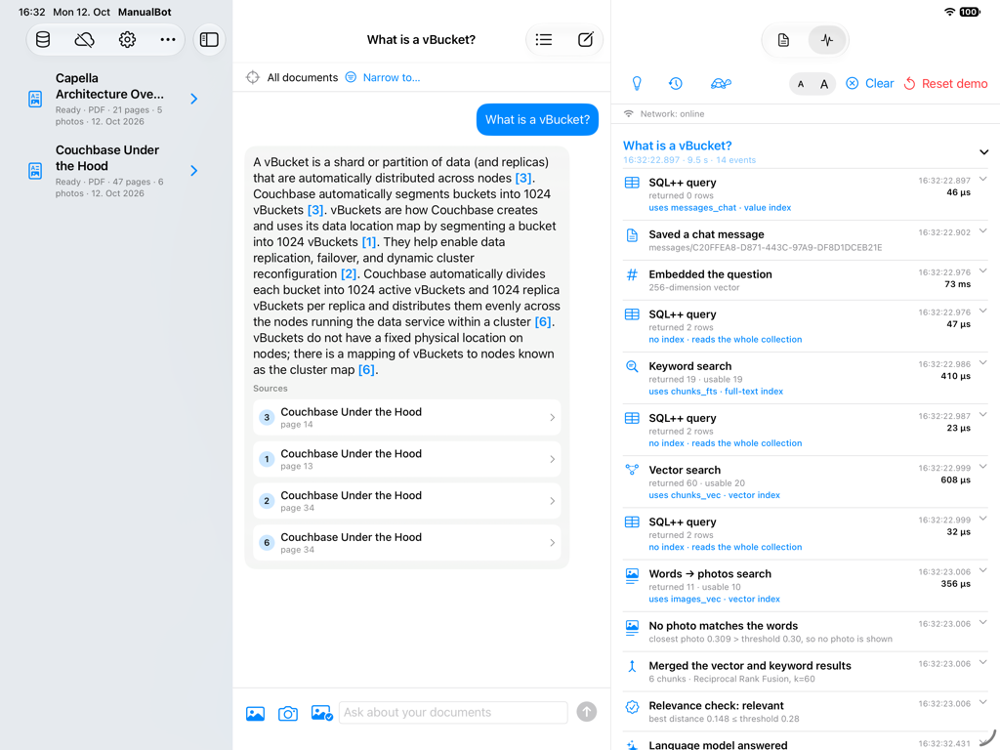

# ManualBot

**Ask your manuals. On the iPad, offline.** ManualBot answers questions about your own documents (PDF, Word, text,
photos) entirely on the device, and every answer cites the page or section it came from.

## What it does

- **Import** PDF, Word, text files and photos; scanned pages and text on photos are read too.
- **Ask in a chat**, with words, a photo, or both. Answers come only from your documents, with citations; if the
  documents don't say, the app says so instead of guessing.
- **Find photos** by how they look or by what you type, even photos nobody captioned.
- **Work offline**: after the models are downloaded, nothing needs the network, and questions, answers and chats never
  leave the iPad.
- **Share a library** between iPads through your own Sync Gateway, if you want to.
- **Show its work**: the X-ray panel traces every database step behind an action, and a database explorer shows what
  is stored.

## Built with

| Layer | Technology |
|---|---|
| App | Swift, SwiftUI, iPadOS 26 on M4/M5 iPads |
| Database | Couchbase Lite 4.1 (Swift, Enterprise Edition) with Vector Search 2.0: documents, chunks, photos, chats, two vector indexes and a full-text index in one database, queried with SQL++ |
| Search | EmbeddingGemma 2 (256-dimension vectors for text and photos) plus full-text search, merged by rank |
| Answers | Gemma 4 E2B, constrained to the retrieved chunks |
| Model runtime | LiteRT-LM (GPU on devices, CPU in the simulator), through a vendored Swift wrapper; models from Hugging Face `litert-community` |
| Text recognition | Apple Vision |
| Sync (optional) | Couchbase Sync Gateway and Couchbase Server |
| Build and specs | XcodeGen, Swift packages (Ports, Core, Adapters), OpenSpec |

<details open>
<summary><b>Screenshot:</b> a cited answer, with X-ray showing the database steps behind it</summary>



</details>

## Answers only from your documents

Every answer cites the page or section it came from; if the documents don't say, the app says so, without calling the
language model.

<details>
<summary>Screenshot: a question the documents don't cover</summary>


</details>

## A photo finds the page it shows

Photograph a figure, a screen or a nameplate: the app reads the text on it, finds the page whose picture looks like it,
and answers from that document. Typed words find photos too, by meaning, even ones nobody captioned.

<details>
<summary>Screenshot: a photo sent alone</summary>


</details>

## One Couchbase Lite database does it all

Documents, chunks with their vectors, photos, chats, the vector indexes and the full-text index live in one Couchbase
Lite database on the iPad, queried with SQL++. The built-in database explorer and X-ray panel show every step.

<details>
<summary>Screenshot: the database explorer</summary>


</details>

## How it works

<picture>
  <source media="(prefers-color-scheme: dark)" srcset="docs/images/ask-flow-dark.svg">
  
</picture>

<picture>
  <source media="(prefers-color-scheme: dark)" srcset="docs/images/import-sync-flow-dark.svg">
  
</picture>

More in [How ManualBot works](docs/architecture.md).

## Run it

Requirements: Xcode 26 or later, [XcodeGen](https://github.com/yonaskolb/XcodeGen) (`brew install xcodegen`); iPadOS 26
on M4/M5 iPads, or an iPad simulator.

```sh
xcodegen generate             # creates ManualBot.xcodeproj from project.yml
open ManualBot.xcodeproj      # run on an iPad simulator, landscape
```

On first launch the app downloads its two models (about 3 GB). **Reset demo** in the X-ray panel loads the sample
documents, two Couchbase whitepapers. To try the app without the models, add the launch arguments
`-uiTestModelStub happy -uiTestSeedDemo`: stand-in models and the sample documents over the real database.

## More

| | |
|---|---|
| [Using ManualBot](docs/using.md) | set up, models, sync, photos |
| [Demo](docs/demo.md) | X-ray, the database explorer, document contents, and the eight-step talk track |
| [How ManualBot works](docs/architecture.md) | the parts, the import and answer pipelines, what syncs |
| [Testing](docs/testing.md) | tests, model evaluations, regenerating these screenshots |
| [Local sync stack](sync/README.md) | Couchbase Server and Sync Gateway in Docker Compose |
