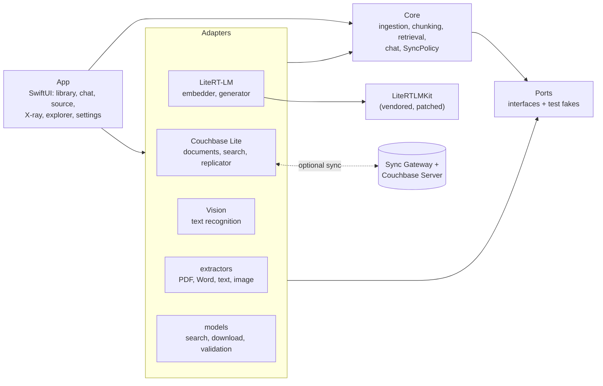

# How ManualBot works

Everything runs on the iPad: two models, one Couchbase Lite database, and Apple's Vision text recognition. Sync to other
iPads is optional and goes only to a server you name. For what each feature does see [using.md](using.md); to watch these
steps happen in the app see [demo.md](demo.md).

<picture>
  <source media="(prefers-color-scheme: dark)" srcset="images/ask-flow-dark.svg">
  
</picture>

<picture>
  <source media="(prefers-color-scheme: dark)" srcset="images/import-sync-flow-dark.svg">
  
</picture>

## What it is made of

- Search: vector search (EmbeddingGemma 2, 256 dimensions) plus keyword search, stored in Couchbase Lite.
- Photos: the same model embeds photos into the same space as the text, in a second vector index in the same database, so
  a photo finds photos that look like it and typed words find photos by meaning ("the red pump"), even uncaptioned ones.
  The text printed on a photo (a nameplate, say) is read by Apple's Vision text recognition.
- Answers: Gemma 4 E2B, constrained to the retrieved chunks.
- Runtime: both models run on [LiteRT-LM](https://github.com/google-ai-edge/LiteRT-LM) (GPU on devices and Mac, CPU in the
  simulator). The one Apple framework left is Vision's text recognition, which reads scanned pages, photos and nameplates:
  it ships with the operating system, needs no model of its own, and replacing it (a second runtime, hand-written
  pre- and post-processing) was judged not worth it.
- Offline: after the models are downloaded, nothing needs the network. There are two exceptions, both under your control: the
  Models page, when you ask it to search for or download another model (see [Models](using.md#models)), and sync, which is off
  until you turn it on and then talks only to the server you name (see [Sync](using.md#sync)). Questions, answers and chats never
  leave the iPad.
- Targets: iPadOS 26 on M4/M5 iPads.

## The parts

The app logic does not know about Couchbase Lite, LiteRT-LM or Vision. It talks to them through small interfaces
(*ports*), and the code that does know about them (*adapters*) implements those interfaces. The tests replace the adapters
with fakes from `PortsTesting`; the app's stub mode (`-uiTestModelStub`) does the same with stand-in models over the real
database.

## Importing a document

1. **Store the original.** The file is saved as a blob beside its JSON record in `documents`, and an indexing job is
   queued in `ingestJobs` (`IngestionService.enqueue`). Jobs resume after the app is killed.
2. **Extract.** PDF, Word, text and image extractors return text blocks and the photos inside the file; Vision reads
   scanned pages and photos (`Packages/Adapters/.../Extraction`, `VisionTextRecognizer`).
3. **Chunk.** Blocks are split into overlapping chunks with their page or heading (`Chunker`).
4. **Photos.** Each photo is read, embedded and written with its caption, a batch per transaction into `images`, and gets
   a chunk of its own so its words are searchable too (`IngestionService.analyzeImages`).
5. **Embed and write.** Chunks are embedded in batches of 16, and each batch is written with its vectors in one transaction
   into `chunks` (`IngestionService.embed`, `LiteRTEmbedder`).
6. **Switch in.** The new chunk set becomes searchable in one atomic switch (`DocumentRepository.activate`). Until then
   search keeps using the previous set, so a re-index is never half visible.

## Answering a question

1. **Rewrite.** A follow-up ("And the X100?") is rewritten into a standalone query using the chat history; a first
   question is used as it is (`QueryRewriter`).
2. **Embed.** The query becomes a 256-number vector (`Retriever`, `LiteRTEmbedder`).
3. **Search, in parallel, in one database** (`Retriever`, `CouchbaseChunkSearch`, `CouchbaseImageSearch`):
   - vector search over `chunks_vec`,
   - keyword (full-text) search over `chunks_fts`,
   - words-to-photos search over `images_vec`,
   - and, when a photo is attached, photo-to-photo search over `images_vec`. The model and part numbers read off a
     nameplate are added to the query's words before steps 2 and 3 (`PhotoQuery`).
4. **Merge.** The result lists are merged by rank (`RankFusion`).
5. **Relevance check.** If the best match is too far away, the answer is "I couldn't find an answer to that in your
   documents." at once, with the closest chunks, and the language model is never called (`ChatService`). A photo sent
   without a question stops here too: it is answered with the matching photos and their pages.
6. **Generate.** Gemma 4 E2B answers from the retrieved chunks only, streaming (`PromptBuilder`, `LiteRTGenerator`).
7. **Check citations.** Only citations of chunks that were actually retrieved are kept. An answer that cites none is
   not grounded in the documents, so it is replaced by the "couldn't find" reply of step 5 (`CitationValidator`).

## Which chunks search can see

A document can have several chunk sets while it is being re-indexed, and only the active set of a ready document may be
found. Filtering for that inside the vector query (a `WHERE` clause) made Couchbase Lite read every candidate row: at
20,000 chunks it cost about 160-330 ms, against a few milliseconds without it. So the index is queried unfiltered, and
visibility is decided from the chunk ID, which encodes `docId:generation:ordinal` (`docId:generation:img:n` for photos).
The query fetches extra candidates and widens its window if too few survive. The comment above the search code
(`CouchbaseChunkSearch.swift`) records the measurement; re-measure with `RUN_BENCHMARKS=1` before quoting it.

## What syncs and what stays on the iPad

| Collection | Holds | Shared through Sync Gateway |
|---|---|---|
| `documents` | document records with their original file as a blob | yes |
| `chunks` | chunk text, position and vector | yes |
| `images` | photos as blobs, captions, text read off them, vectors | yes |
| `chats`, `messages` | conversations | no |
| `ingestJobs` | indexing queue | no |
| `localMeta` | facts about this device's database, such as each vector index's dimension | no |

Indexes (`chunks_vec`, `chunks_fts`, `images_vec`) are never replicated: each iPad builds its own from the documents it
holds, so a received document is searchable without being embedded again. Shared vectors must all come from one embedding
model, so sync pauses while an iPad uses another one (`SyncPolicy`). See [Sync](using.md#sync) for how it behaves and
[`sync/`](../sync/README.md) for a local server.

## Where the code is

- `App/`: SwiftUI app (library, chat, source viewer, model setup, X-ray, database explorer, settings).
- `Packages/Ports`: the interfaces between parts (including `LibrarySync`), plus test fakes.
- `Packages/Core`: model-independent logic (chunking, retrieval, chat, ingestion, and `SyncPolicy`, which decides when sync may run).
- `Packages/Adapters`: Couchbase Lite (including the replicator, `CouchbaseLibrarySync`), LiteRT-LM (embedding and answers), Vision text recognition, extractors, downloader.
- `Packages/LiteRTLMKit`: vendored, patched Swift wrapper for LiteRT-LM (see its [README](../Packages/LiteRTLMKit/README.md)).
- `sync/`: Couchbase Server and Sync Gateway as a Docker Compose stack for trying sync (see its [README](../sync/README.md)).
- `openspec/`: the specifications. `openspec/specs/` holds one spec per capability (ingestion, retrieval, chat, photos,
  sync, models, X-ray, explorer, ...); `openspec/changes/archive/` holds each past change with its proposal, design and tasks.
