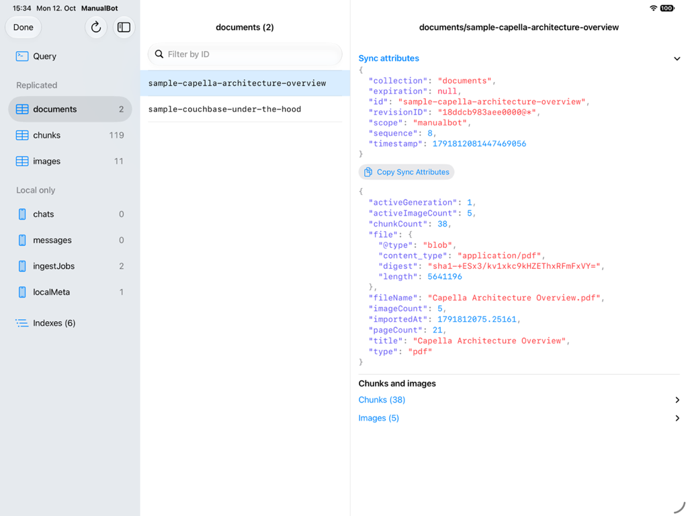
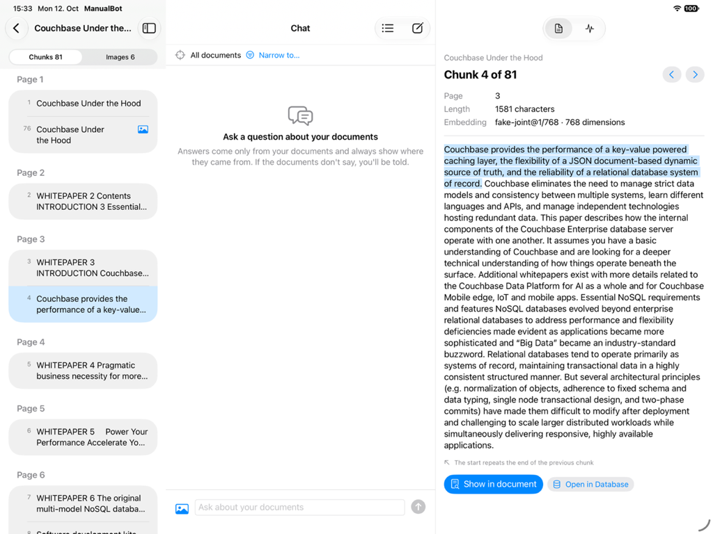
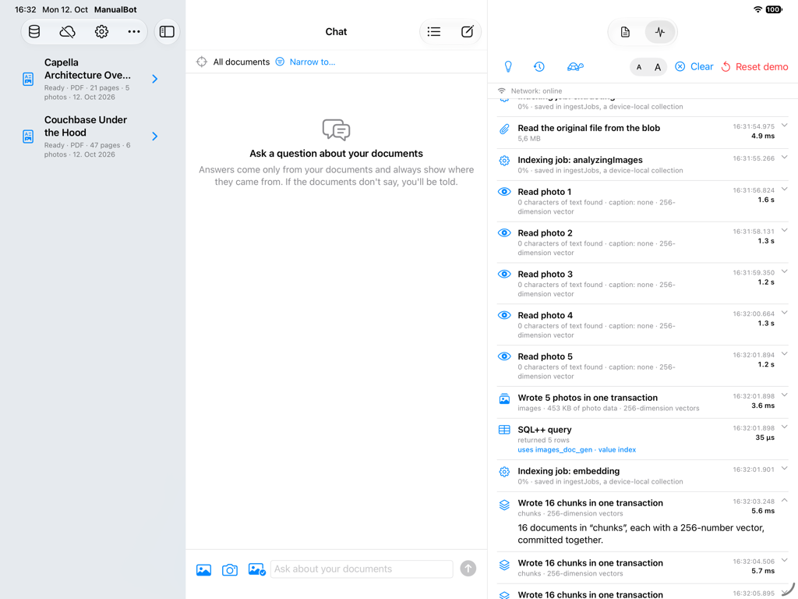
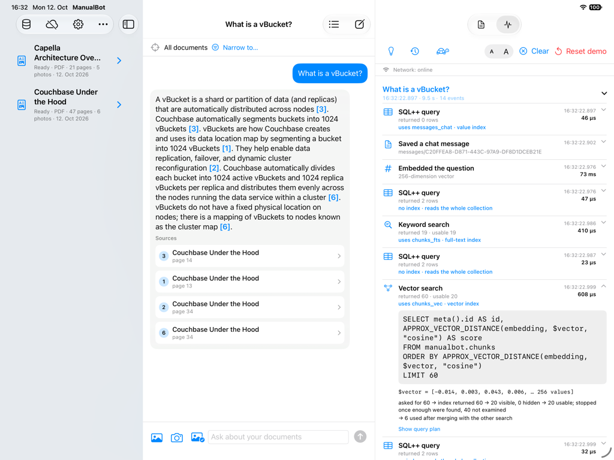
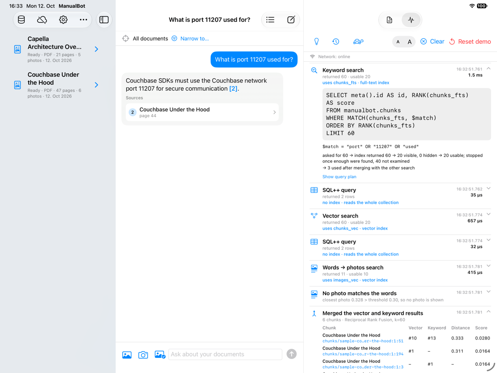
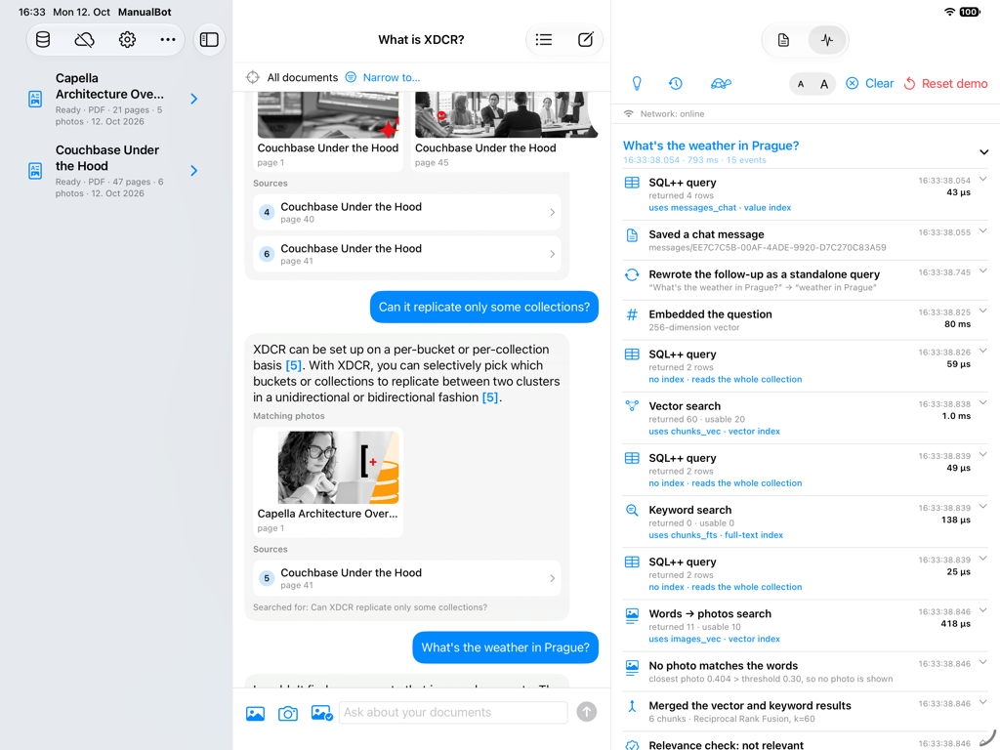
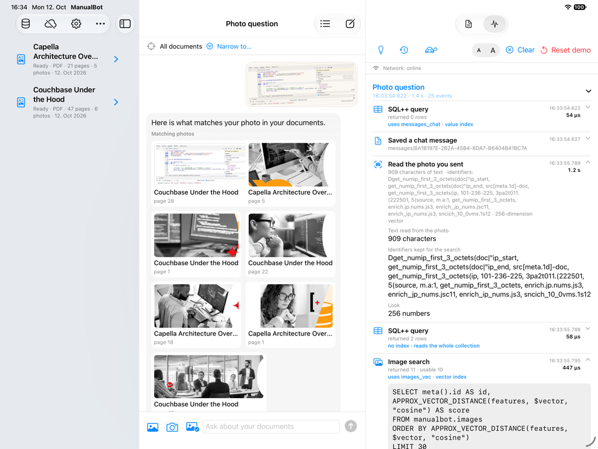
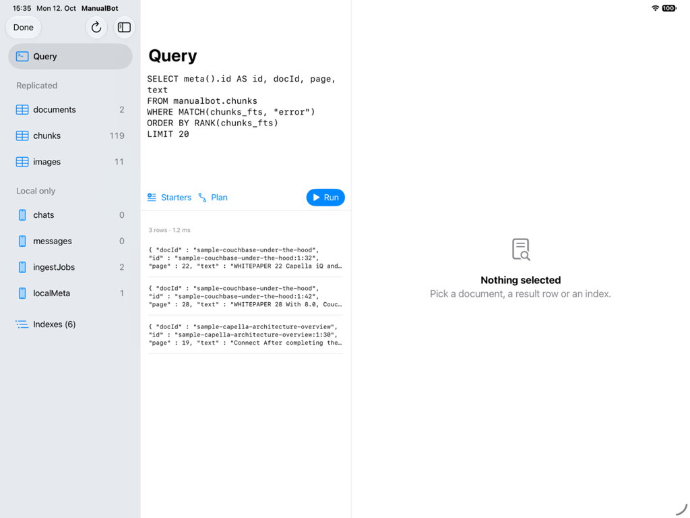
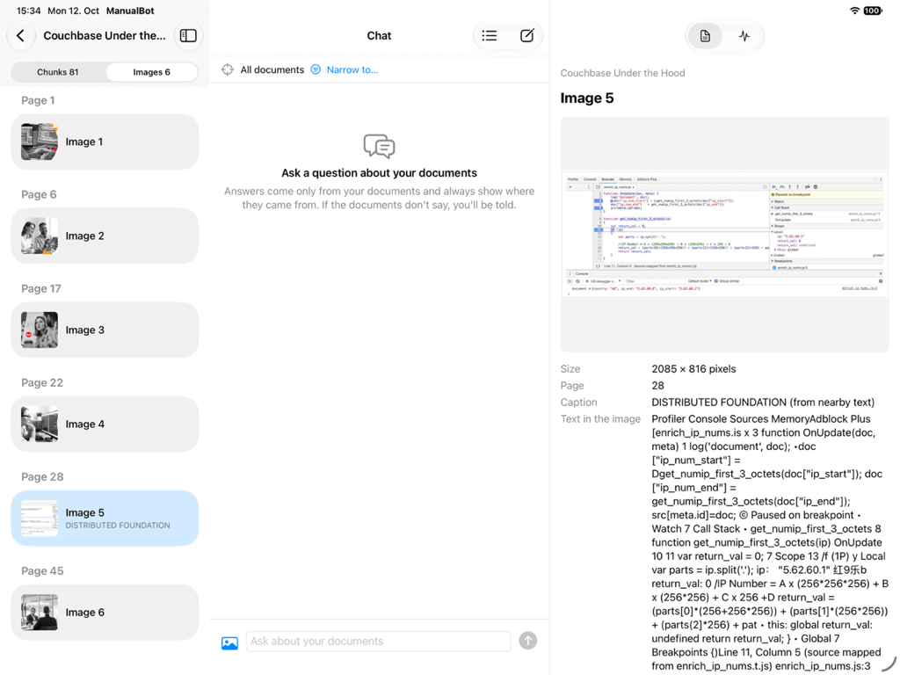

# Demo: X-ray, the database explorer and the talk track

Everything you need to show what the app and Couchbase Lite do behind each action. For what each feature does see
[using.md](using.md); for how the parts fit together see [architecture.md](architecture.md).

## X-ray

For showing what the app and Couchbase Lite do behind each action. There is nothing to switch on: the right-hand column
has a `Source | X-ray` switch, and tapping a citation or a document returns to Source.

X-ray lists every import, question, source opening, re-index and deletion as a group, with each database step inside
(for photos: each photo read, the batch of photos stored as blobs beside their JSON, and the image search over the second
vector index):
the SQL++ as executed with its parameters, the time, the index the query plan uses (the raw plan is one tap away), how
many rows the index returned, how many were visible and how many were used, and the stored JSON of any chunk or
document ID you tap. "Why it matters" adds one sentence per step. "Slow reveal" shows a burst of steps one at a time,
the text buttons enlarge the panel for a projector, and "Reset demo" (after confirming) clears the library and chats
and imports the two sample documents, Couchbase whitepapers bundled as PDFs: *Couchbase Under the Hood* (47 pages) and
*Capella Architecture Overview* (21 pages). Their architecture diagrams are vector drawings, not pictures, so the photos
the app stores from them are the stock photos, the covers and one technical figure: the Eventing debugger screenshot on
page 28 of *Under the Hood*. The chat's sample-photo button attaches a photo of that figure.

Run it on the real database without the real models: `-uiTestModelStub happy -uiTestSeedDemo` (the two PDFs) or
`-uiTestSeed` (the generated X200 documents the tests use). The panel then shows a
"stub models" notice, because the distances come from a stand-in embedder and mean nothing; use the real models when you
want to talk about relevance.

## Database explorer

The Library toolbar has a **Database** button that opens a full-screen, read-only view of the local Couchbase
Lite database; Done returns to exactly where you were. Collections are grouped as replicated and local only, each with its
document count (read when it opens, and again with Refresh). Pick a collection to page through its document IDs (filter by
ID), then a document to see it as stored: vectors shortened with "Show in full", image and text blobs with a preview, and
fields that name another document (`docId`, `chatId`, `imageId`) are links, with Back returning to where you came from.
A document record also lists its chunks and images. Indexes shows each index's kind and settings. **Query** is a SQL++
console: pick a starter (keyword search, the chunks of one document, ingest jobs by state) or type a SELECT, see up to
200 rows with the time, and open the query plan. Parameters (`$name`, including `$vector`) are not supported. Tapping a
document ID in X-ray opens the explorer at that document. It never writes, and it adds nothing to the X-ray log.

Above a document's JSON, **Sync attributes** is collapsed by default. Expanding it loads the local Couchbase Lite document
ID, scope, collection, revision ID, sequence, raw revision timestamp and expiration; no server lookup is made. Loading works
offline and with sync disabled. The values are a local snapshot and do not indicate whether a revision reached the server.
Collapse the section to hide its values while you inspect the document body.

## Document contents

To see how a document was split, tap the **›** at the right of a ready document in the Library (photos have nothing to
open). The sidebar then lists the document's chunks or its images (the switch at the top), grouped under page headers for
a PDF and under headings for other files. A chunk that stands for a photo carries a photo mark. Tap one and the right-hand
column shows it: for a chunk, its number out of the total, page and heading, length, embedding model and number of
dimensions, and its full text, with the sentences it repeats from the previous chunk and the next chunk tinted
(Previous and Next step through the list); for an image, the stored picture (pinch to zoom), its size, caption and where
the caption came from, and the text read off it. **Show in document** opens the original at that spot with the chunk
highlighted, and **Show chunk** on an image jumps to the chunk that makes it searchable. The list is read when it opens and
again when a re-index finishes; X-ray shows that read as one "Contents of …" step. Nothing is written, and previews run
no queries, so stepping through chunks adds nothing to the X-ray log.

## Talk track

Start with **Reset demo**; the questions below are answered from the two whitepapers.

1. **Import.** Tap Reset demo, then watch the Import groups: the file is stored as a blob next to its JSON record, the
   chunks and their vectors are written 16 to a transaction, and the new chunk set is made searchable in one switch at the
   end. The indexing job is saved in a collection that never replicates.

   

2. **Ask.** "What is a vBucket?" Open the vector search: one SQL++ query over the same database that holds the
   documents, the index it used, and the stored chunk with its 256-number vector as an ordinary JSON field. The answer
   cites *Couchbase Under the Hood*, pages 13, 14 and 34.

   

3. **Exact tokens.** "What is port 11207 used for?" Open the keyword search and the merge: a full-text query in the same
   engine, and the two result lists merged by rank. A port number means little to a vector, but the keyword search
   finds the one page that says it (page 44: the port the SDKs use for TLS).

   

4. **Follow-up.** Ask "What is XDCR?", then "Can it replicate only some collections?", and show the rewritten standalone
   query ("Can XDCR replicate only some collections?") and the answer from page 41.
   Then ask something the documents do not cover ("What's the weather in Prague?") and show the relevance check that stops
   the model being called.

   

5. **Photo.** Tap the sample-photo button and send the photo alone: it is the Eventing debugger screenshot as
   photographed. The app reads the code off it, finds page 28 of *Couchbase Under the Hood*, whose figure looks like it, and
   lists that page's chunks (the stock photos in the two PDFs follow, further away). In X-ray, open the photo analysis, then the image
   search: a second vector index (`images_vec`) in the same database, queried with the same SQL++, and the merge now has
   a third list. Add "what is this used for?" to get a cited answer from the Eventing section. Then type "a JavaScript
   debugger paused on a breakpoint" with no photo: the question's own vector searches the same photo index (Words →
   photos search), and a fourth column appears in the merge.

   

6. **Look inside.** Tap Database after an import: the chunks each point back to their document, ingest jobs and the
   vector-index settings sit in collections that never replicate, and the keyword starter runs the same full-text query
   in the console, with a plan that names `chunks_fts`.

   

7. **Chunks.** Tap › next to *Couchbase Under the Hood*, switch to Images and open the figure on page 28, then Show chunk
   to land on the text that makes the figure searchable. To show the overlap, step through two chunks of the same page
   and point out the sentences the next chunk repeats, which is why a question that lands on a chunk's edge still finds
   its answer.

   

8. **Offline.** Turn on airplane mode: the network indicator flips and everything above still works and is still traced.

## If asked: "so filtered vector search is slow?"

At 20,000 chunks, adding the visibility filter to the vector query cost about 160-330 ms, against a few milliseconds
without it. So the index is queried unfiltered and visibility (the active generation of a ready document) is decided from
the chunk ID, which encodes document, generation and position. The row funnel in X-ray shows this: rows the index
returned, rows that were visible, rows used. It also keeps a re-index in progress invisible to search until it is switched
in. These figures were measured earlier in this project and are recorded in the comment above the search code
(`CouchbaseChunkSearch.swift`); re-measure with `RUN_BENCHMARKS=1` before quoting them, and do not generalise them to other products.
