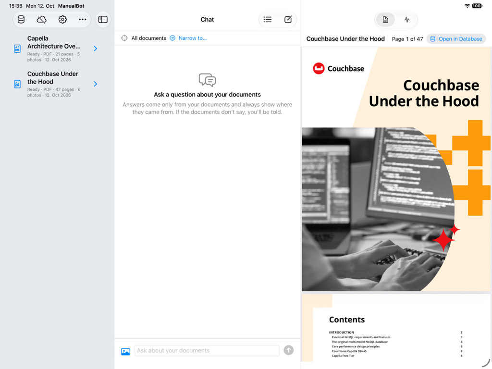
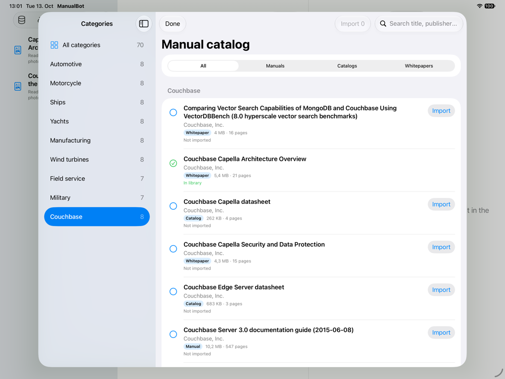
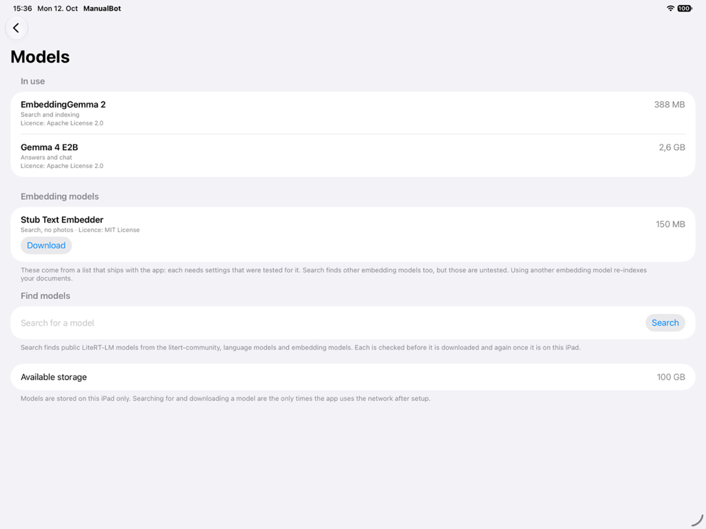
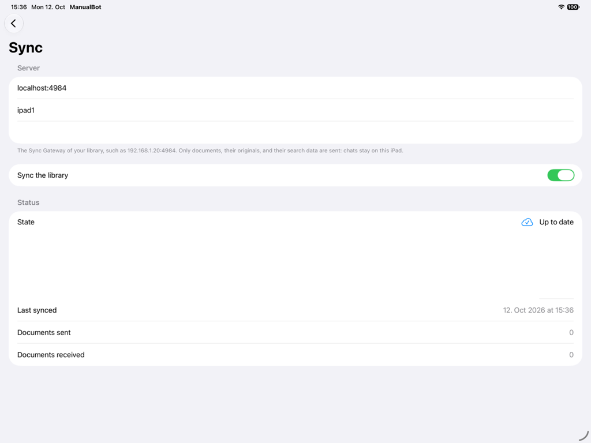
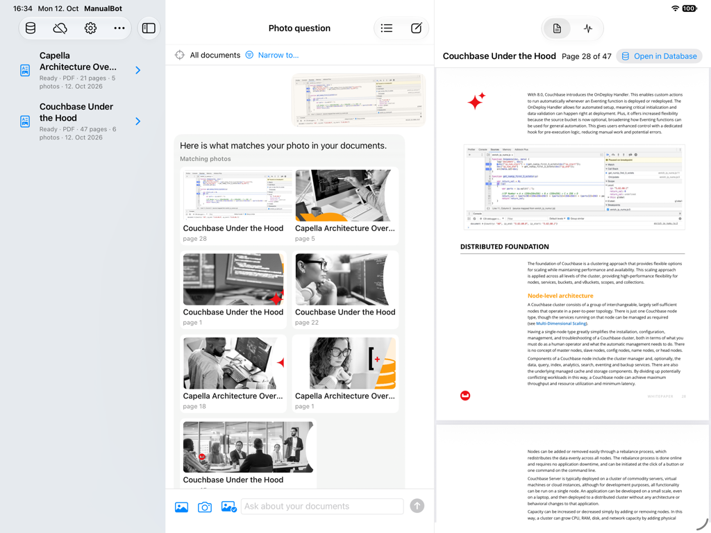

# Using ManualBot

How to set the app up and what each part of it does. For the demo walkthrough see [demo.md](demo.md); for how it works
inside see [architecture.md](architecture.md).

## Set up



Requirements: Xcode 26 or later, [XcodeGen](https://github.com/yonaskolb/XcodeGen) (`brew install xcodegen`).

```sh
xcodegen generate             # creates ManualBot.xcodeproj from project.yml
open ManualBot.xcodeproj      # run on an iPad simulator, landscape
```

Nothing is built into the app. On first launch it needs a network connection to download two models from Hugging Face,
each verified by checksum: the embedding model (EmbeddingGemma 2, 388 MB) first, so documents can be imported as soon as it
arrives, then the language model (Gemma 4 E2B, 2.6 GB). Until the embedding model is installed nothing can be imported. If
a model file is deleted later, the app returns to the setup screen for it and keeps every document and chat. When an update
replaces a default model (the earlier Gemma 4 E4B, 3.7 GB, was one), the old file is deleted at launch so it does not leave
gigabytes behind, unless you chose that model on the [Models page](#models): it then stays until you delete it.

**After an update that changes the embedding model**, every document is re-indexed automatically in the background
(the library shows "Updating index"), because vectors from different models cannot be compared. Keyword search keeps
finding the documents meanwhile, and vector and photo search return as each one finishes. Chats and originals are untouched.
A document that was half indexed by the old model starts over with the new one: one chunk set never mixes vectors of two models.

In the simulator both models run on the CPU (its Metal cannot run them), so indexing and answers are much slower than on an iPad.

### Try it without the real models

Add launch arguments in the scheme (Run, Arguments): `-uiTestModelStub happy -uiTestSeed`. This uses the real database,
extraction, ingestion, retrieval and chat logic with stand-in models (text on photos is still read by the operating system; one stand-in model embeds words and photos, and the words "x100 nameplate" are scripted to find the sample nameplate photo), and five sample documents already indexed, including a photo and a manual with a photo in it.
`-uiTestSeedDemo` instead of `-uiTestSeed` seeds the two Couchbase PDFs that Reset demo imports, and `-uiTestPhoto sample`
makes the photo button attach the demo's sample photo instead of the X200 nameplate.
Other flags: `-uiTestSlow` (slow, stoppable answers), `-uiTestSearch results|offline` (what the Models page finds: a scripted
set of language models, or a failed search as with no connection), `-uiTestSync off|syncing|upToDate|paused|error` (what sync
reports, with a stand-in replicator that never reaches a server; any value but `off` also fills in the Sync settings and turns
sync on). Stub scenarios: `happy`, `llmFailsOnce`, `lowStorage`.
The stub offers a second, text-only embedding model, to try a switch of embedder.

## Manual catalog

A new library is empty, so the app offers a bundled list of 70 public manuals, product catalogs and whitepapers in nine
categories: Automotive, Motorcycle, Ships, Yachts, Manufacturing, Wind turbines, Field service, Military and Couchbase.
Open it from **Import → Manual catalog…** in the library's toolbar, or from the empty library.



- **Find.** Pick a category on the left, filter by kind (manual, catalog or whitepaper; categories with none are hidden), or
  search: the text is matched against title, publisher and category. Tap an entry for its publisher, licence note and the
  address the file comes from.
- **Import.** Tap Import on an entry, or tick several and tap Import N. Each downloads on its own, and one that fails does not
  stop the others. A row shows its state: not imported, downloading (with Cancel), queued for indexing, in the library, or
  failed with the reason and Retry. The document is then an ordinary one: indexed, searchable, shared by sync.
- **Already there.** An entry whose document is in the library, imported here or on another iPad that shares the library, shows
  "In library" and is not downloaded again. Deleting the document makes the entry importable again.
- **Network.** Browsing and searching send nothing. The first download from a publisher's host names it and asks first; after
  that the host is remembered. Only the host of an entry you import is contacted, and nothing about you or your library is
  sent. Offline you can browse, but importing is disabled with an explanation.
- **When it fails.** A publisher can refuse automatic downloads (the row offers **Open in browser**, and you can import the
  saved file with Files as usual), move the file (the link no longer leads to a PDF), or be slow; a file over 20 MB is not
  downloaded. Nothing partial is kept.

Everything in the list is the publisher's own file, linked and never copied; each entry shows its licence note. How the list is
chosen and kept current is in [manual-catalog.md](manual-catalog.md).

## Models



The first-run setup installs the default pair. The **Models** page (**Settings**, the gear in the library toolbar, then *Models*)
is where you change it.
It lists what is **in use**, what is **installed** but not in use, the **embedding models** the app offers, and a search for
**language and embedding models**.

**Finding and downloading.** The app ships a list of embedding models, because each one needs settings (prompt templates,
chunk sizes, the distances that separate a match from a poor one) that were tested for it. Search finds the public
`litert-community` models on Hugging Face, language models and embedding models, each marked with its kind. Each result is
judged before anything is downloaded, from its size and the first 64 KB of the file: *Checked after download* (the file
does not say which runtime it needs), *Unknown kind of model*, *Not a LiteRT-LM model file*, or *Too large for this iPad*
(the file is over 45% of the iPad's memory). The last three cannot be downloaded. Once a file is downloaded and its checksum
verified, the app's own LiteRT-LM runtime reads it and has the last word: the wrong type, a newer runtime than the app's, a
language model with a context under 4,096 tokens, or an embedding model that reports no vector size removes the file and
shows why. A downloaded model is installed but not in use.

**Untested embedding models.** An embedding model found by search that is not in the list is marked *Untested*. It is used
with generic settings: no prompt templates, the vector size and an input length the file reports, and the distances the app
ships with, so how well search works with it is unknown. The confirmation says so, and you can switch back to a tested model
at any time (everything is then indexed again). A search result that is the very file of a list entry installs as that tested entry.

**Using a model.** *Use* asks first and names the cost. For an embedding model: how many documents will be re-indexed,
that each is found by keywords only until its re-index is done, and that photo search is unavailable until it finishes
(or, for a model that cannot analyze photos, for as long as it is in use). For a language model: that an answer being
written will stop. After you confirm, the switch happens at once: an answer being written is kept as a stopped answer, indexing
stops where it is, the services are built again from the new model and indexing carries on. If the new model cannot be loaded,
the previous one is back in use and the page says why. Chats, documents and their originals are never touched.

**Photos.** A model without photos in its vector space (the stub's text-only embedder, say) turns photo import and photo
questions off, with an explanation that names it; PDF and Word files still import and search by text. Photo documents already in
the library keep the vectors they had: search skips them (they belong to another model) and they are valid again when a
model with photos is back in use.

**Deleting.** Any installed model that is not in use can be deleted; the one in use cannot.

**Network.** Searching and downloading on this page are the only network use of the Models page, and only when you ask (the [manual catalog](#manual-catalog) and [sync](#sync) have their own). Nothing
about your documents, questions or answers is sent. The X-ray panel shows each request as a *Model search* or
*Model download* operation, and importing documents and asking questions record none. **About** lists every installed model with its licence as its
publisher states it, and links to the full terms.

The list offers EmbeddingGemma 2 Text Vision 440M (the default, 388 MB), Text 270M (165 MB, no photos) and 740M (485 MB; its audio and
video are not used). All three are one model with different encoders loaded and gave identical results in the evaluations
([`openspec/changes/archive/2026-10-09-add-model-settings/evaluations/embedder-candidates.md`](../openspec/changes/archive/2026-10-09-add-model-settings/evaluations/embedder-candidates.md)).

To add an embedding model to the list (and so make it tested), give it an entry in `App/Resources/EmbedderCatalog.json` with a profile, and settle
the profile with the retrieval and photo evaluations first (`EvalTests`, `ImageEvalTests`): the model has to meet the recall baselines
in the `hybrid-retrieval` and `image-search` specs.

## Answer style

Settings → **Answer style** has one slider that sets how readily the app answers. Its position is the relevance distance a
passage must be within to be used, shown with two decimals; lower is stricter. The four named stops along it also decide
what happens when your documents don't answer the question. That covers three cases: nothing was close enough, the
language model found no answer in the passages, or its answer cited none of them.

| Stop | Distance (EmbeddingGemma 2) | When the documents don't answer |
|---|---|---|
| Strict | 0.22 – 0.25 | "I couldn't find an answer" with the closest passages. The language model is not asked. |
| **Balanced** (default) | 0.26 – 0.30, starting at 0.28 | The same. |
| Conversational | 0.31 – 0.34 | A short reply in your language about what the app can do. It states no facts and lists no passages. |
| Open | 0.35 – 0.38 | An answer from the language model's general knowledge, with the closest passages below. It can be wrong. |

Replies under Conversational and Open that don't come from your documents are marked **Not from your documents** and have
no sources, and the mark stays after a relaunch. Answers that do come from your documents are cited as usual at every
stop. The setting is remembered as a distance from the embedding model's tuned value, so after a switch to another
embedding model Balanced is still that model's tuned point. **Reset to Balanced** returns to the default, which is how the
app behaved before the setting existed. The evaluations always run at Balanced.

## Sync



Several iPads can share one library. Turn it on under **Settings → Sync** (or tap the cloud in the library toolbar): enter the
address of your Sync Gateway, the iPad's user name and password (kept in the Keychain), and switch it on. A document imported
on one iPad then appears on the others, searchable without being indexed again, because the chunks and their vectors travel
with it. Any iPad can import, rename, re-index and delete; deleting removes a document from every iPad, and the confirmation
says so.

To try it, [`sync/`](../sync/README.md) has a Docker Compose stack that starts Couchbase Server and Sync Gateway, already set up
for the app, with one command: `cd sync && docker compose up -d --wait`.

- **What is shared.** Documents (with their original files), chunks and photos. Chats and messages stay on each iPad, and so do
  the vector and keyword indexes: each iPad builds its own from the documents it holds.
- **One embedding model for everyone** (the *fleet model* in the code). Shared vectors have to come from one model, the app's
  default (EmbeddingGemma 2). An iPad that switches to another embedding model pauses sync, and says so on the Sync page and
  in the Models confirmation; it resumes by itself once the iPad is back on the default and every document has been indexed
  with it.
- **Originals up to 20 MB.** That is the largest attachment Sync Gateway takes, so larger files are refused at import, with or
  without sync. A larger one imported by an older version stays on its iPad and is listed on the Sync page as not shared.
- **Arriving documents.** A document received from another iPad is searchable only when all its chunks and photos have
  arrived, and shows as *Arriving…* until then. One another iPad is still indexing shows as *Being indexed on another device*.
- **Offline.** Sync never gets in the way: import, search and chat work with no connection, and changes are exchanged when
  the server is reachable again.
- **Network use.** With sync on, the only requests go to the server you entered, and carry documents and their search data,
  never a question, an answer or a chat. The X-ray panel shows each burst of replication as a *Sync* operation: documents
  sent and received, anything the server refused, and the moment a received document became searchable.

A real iPad reaches a server on your network over `ws://` (the app allows plain connections to local addresses only, and iPadOS
asks once to let it use the local network); use `wss://` for anything else.

## Photos



**Import.** JPEG, PNG and HEIC files import like any document (picker, share sheet, drag and drop). A photo document is
findable by its title, by the text read from it, and by how it looks. Photos *inside* PDF and Word files are found too:
each one is stored with its page (PDF) or section (Word) and a caption, taken from the text next to it or the author's
description. Logos, icons, pictures repeated on many pages, and full-page scans are skipped. Documents imported before
photos were supported get their photos when they are re-indexed.

**Ask with a photo.** In the chat, the camera button takes a photo and the photo button picks one; send it alone or with a
question.

- Photographing a **nameplate** reads its model and part numbers (ratings, dates and protection classes are left out) and
  searches the documents for them, so "how do I descale it?" with a photo of the unit finds the right manual.
- A photo **alone** is answered with the library photos that look like it, each with its document and page, and the
  chunks from those pages. Nothing is generated.
- An answer shows the photos on the pages it cites, and tapping one opens that page.

**Ask with words.** A typed question also searches the photos by meaning, so "where is the drain plug?" finds a photo of
the drain plug that nobody captioned, and the answer shows it beside the text, with the chunks of its page. Matching
photos only add to the answer: a photo whose look merely resembles the words never makes a question answerable on its own.

Photos are analyzed on the iPad and are never given to the language model: answers still come only from document text.
A photo kept with a question is stored without its metadata (no location, camera or time).

**Simulator.** Photo search works in the simulator too, on the CPU with the real embedding model (about a second per
photo), or in stub mode with stand-in features (`-uiTestModelStub`).

The distances that count as a match are `imageMaxDistance` (photo to photo) and `textToImageMaxDistance` (words to photo)
in `RetrievalConfiguration`. Both are **provisional**: tuned on 14 Wikimedia Commons photos of equipment, where the query is
a *different* photo of the same kind of thing, not photos taken in the field. Re-tune them with real photos before relying on
them (see [Photo evaluation](testing.md#photo-evaluation), `IMAGE_EVAL_DIR`).
